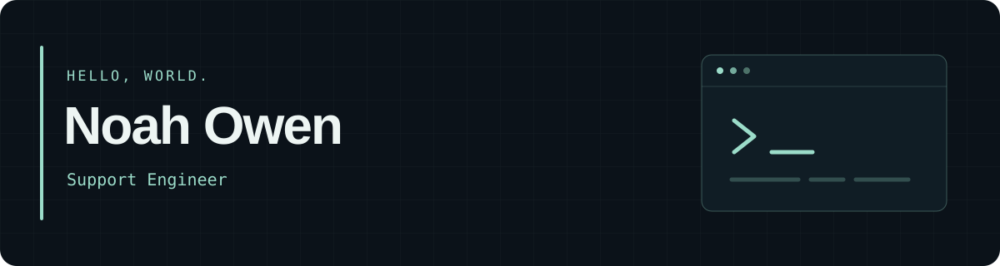

# Hi, I'm Noah.

Exploring systems administration, cybersecurity, and software development through hands-on projects.

[LinkedIn](https://linkedin.com/in/nowen99) · [Projects](#projects) · [Certifications](#certifications) · [CS50](#cs50)

## Projects

A growing collection of things I build, automate, and learn along the way.

<!-- NEW PROJECTS
Add completed projects here, above the labs. Duplicate this block for each project:

### [Project name](REPOSITORY_URL)
One sentence explaining what it does and the problem it solves.

**Built with:** Technology · Technology

[Source](REPOSITORY_URL) · [Demo](DEMO_URL)

Remove the demo link if there is no public demo. Keep credentials and private data out of screenshots.
-->

### Infrastructure & security labs

| Project | What I explored | Repository |
| :--- | :--- | :--- |
| **Docker & Kubernetes lab** | Ran NGINX with Docker, Compose, and Kubernetes. Traced a stalled rollout to a readiness check returning HTTP 404 and verified the fix. | [View repository](https://github.com/Nowen99/kubernetes-incident-response-lab) |
| **Active Directory home lab** | Setting up Active Directory in Oracle VirtualBox and adding users with PowerShell. | [View repository](https://github.com/Nowen99/active-directory-home-lab) |
| **Azure Sentinel SIEM** | Connecting Azure Sentinel to a live virtual machine acting as a honeypot. | [View repository](https://github.com/Nowen99/sentinel-honeypot-lab) |

## CS50

**[CS50 problem set solutions →](https://github.com/Nowen99/CS50-Code)**

My solutions from Harvard's CS50 course.

## Certifications

### IT & security

- [**CompTIA Security+**](https://www.credly.com/badges/e9ce1f03-5545-4436-a6f2-6e4042d82cc8)
- [**CompTIA A+**](https://www.credly.com/badges/ab2adef1-8666-404e-a1ce-628041145c56/linked_in_profile)
- [**CompTIA Linux+**](https://www.credly.com/earner/earned/badge/a1480efc-909a-4363-9033-29f3676b9aa9)
- [**Microsoft 365 Fundamentals (MS-900)**](https://learn.microsoft.com/en-us/users/noahowen-6204/credentials/a2f3731460dcb736)

### Additional learning

- [Career Essentials in System Administration — Microsoft & LinkedIn](https://www.linkedin.com/learning/certificates/11098f95bdb2898040ecdf5ff60a297c940fab4548f50e7a395e4124cc4742f0)
- [Networking Basics — Cisco Networking Academy](https://www.credly.com/badges/67b89b2b-1a15-4fe5-a5d2-de597eeb9ec8/public_url)
- [Project Management Foundations](https://www.linkedin.com/learning/certificates/0e9e2f8bea06a88118bce136f6386e0b6df9e4e1bb98f1ef1eb235b366098537)

---

### Let's connect

Find me on **[LinkedIn →](https://linkedin.com/in/nowen99)**.
